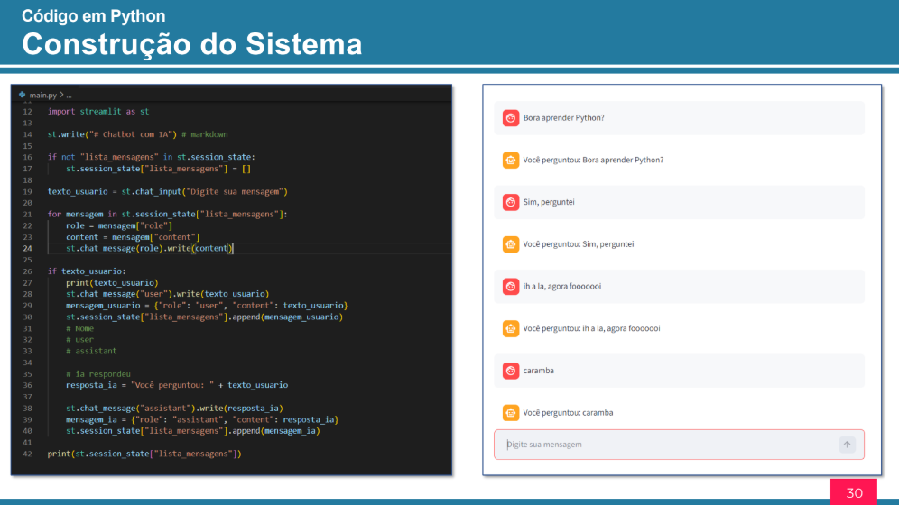
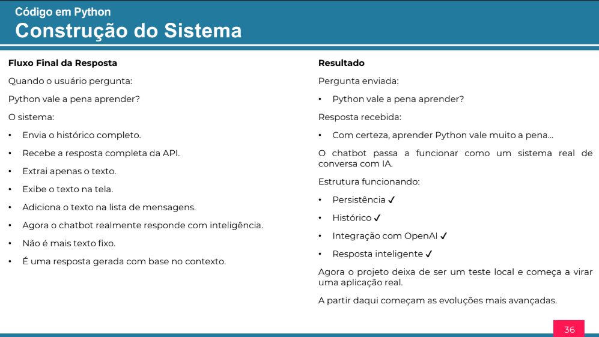

# 🤖 Jornada Python — Aula 03

Projeto desenvolvido durante a **Jornada Python**, evento promovido pela **Hashtag Treinamentos**.

Nesta aula, o foco foi criar um **chatbot com Inteligência Artificial em tempo real**, utilizando Python, Streamlit e integração com o **Gemini** através da biblioteca OpenAI.

---

## 📚 Sobre a aula

O projeto consiste na criação de um chatbot capaz de receber mensagens do usuário, enviar essas informações para uma **Inteligência Artificial** e exibir respostas geradas de acordo com o contexto da conversa.

Durante a construção do projeto, foram trabalhados conceitos como:

- Criação de uma interface de chat
- Entrada de mensagens do usuário
- Exibição das mensagens no chat
- Organização das mensagens em listas e dicionários
- Armazenamento do histórico da conversa
- Utilização do `st.session_state`
- Integração com uma API de Inteligência Artificial
- Processamento da resposta recebida pela API

---

## 🛠️ Tecnologias utilizadas

- **Python**
- **Streamlit**
- **OpenAI**
- **Gemini**
- **VS Code**

---

## 🖥️ Interface do chatbot

A interface foi desenvolvida utilizando o **Streamlit**, permitindo criar uma aplicação web utilizando Python.

Entre os recursos utilizados estão:

- `st.write()`
- `st.chat_input()`
- `st.chat_message()`
- `st.session_state`

Para executar o projeto:
```bash
streamlit run main.py
```

---

## 💬 Histórico das mensagens

As mensagens da conversa são organizadas em uma **lista de dicionários**.

Cada mensagem possui informações como:
```bash
{
    "role": "user",
    "content": "Mensagem do usuário"
}
```
ou:
```bash
{
    "role": "assistant",
    "content": "Resposta da IA"
}
```

O `role` identifica quem enviou a mensagem, enquanto `content` contém o texto da mensagem.

---

## 🧠 Mantendo o histórico com `st.session_state`

Como o Streamlit executa o código novamente quando a aplicação é atualizada, foi utilizado o `st.session_state` para manter a lista de mensagens durante a sessão.

Dessa forma, o chatbot consegue manter o **histórico da conversa** e enviar as mensagens anteriores junto com uma nova pergunta.

---

## 🔗 Integração com Inteligência Artificial

A aula apresenta a integração do chatbot com o **Gemini**, utilizando a biblioteca **OpenAI** para realizar a comunicação com a API.

A chave de API é utilizada para autenticar as requisições.

> ⚠️ Importante: nunca publique uma chave de API real no GitHub ou em qualquer repositório público.

A resposta recebida pela API contém diversas informações. O projeto extrai o conteúdo textual da resposta para exibi-lo no chat.

---

## 🔄 Funcionamento do chatbot

O funcionamento básico do sistema segue este fluxo:
```bash
Usuário
   ↓
Envia uma mensagem
   ↓
Mensagem é adicionada ao histórico
   ↓
Histórico é enviado para a IA
   ↓
IA processa a conversa
   ↓
Resposta é recebida
   ↓
Resposta é exibida no chat
   ↓
Resposta é adicionada ao histórico
```
---

### 📚 Projeto apresentado na apostila

<p align="center">
  
</p>
<p align="center">
  
</p>

---

## 🎓 Jornada Python

Este projeto faz parte da **Jornada Python da Hashtag**, realizada em **2024**.

A jornada teve duração total de **8 horas** e foi concluída em **10/10/2024**.

Este repositório contém o projeto desenvolvido na **Aula 03 — Chatbot com IA em tempo real**.

---

## 👩‍💻 Autora

**Lua**

Estudante de **Sistemas para Internet**, com foco em desenvolvimento e tecnologia.

---

✨ Projeto desenvolvido como parte da minha jornada de aprendizado em Python.
